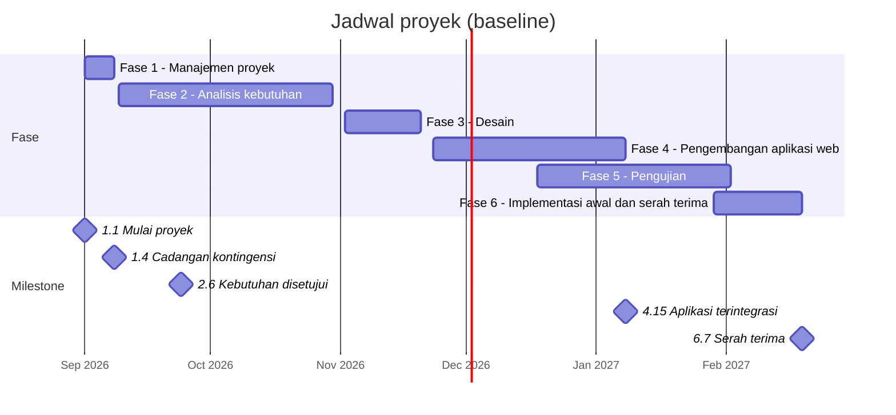

# Status proyek

Terakhir ditinjau: 2026-11-26

Halaman ini merangkum jadwal ProjectLibre di GitHub agar tim bisa melihat
milestone dan bukti progres tanpa membuka ProjectLibre.

## Rencana vs. progres aktual

XML ProjectLibre yang diberikan berisi 52 tugas, termasuk 5 milestone. Namun,
semua tugas masih memiliki `PercentComplete = 0` dan tidak memiliki tanggal
mulai/selesai aktual. Jadi tanggal di bawah adalah baseline rencana, bukan catatan
realisasi. XML lengkap tidak disertakan di repositori publik ini.

`Perlu verifikasi` berarti repositori belum memuat bukti penyelesaian; bukan berarti
aktivitas tersebut pasti belum dilakukan di luar repositori.

## Ringkasan saat ini

- Proyek berada dalam jendela Fase 4 yang direncanakan (2026-11-23 sampai
  2027-01-08).
- Modul inti web tersedia: [produk](client/src/pages/Products.tsx),
  [stok](client/src/pages/Stock.tsx), [dashboard](client/src/pages/Dashboard.tsx),
  [gudang](client/src/pages/Warehouse.tsx), dan [kasir/POS](client/src/pages/Sales.tsx).
- Docker Compose menggabungkan database, API, dan web. Build produksi frontend,
  type-check API, dan validasi konfigurasi Compose berhasil pada 2026-11-26.
- Pengecekan tersebut bukan pengganti pengujian fungsional atau UAT pemilik/petugas.
  Saat ditinjau, repositori belum memuat laporan pengujian, persetujuan kebutuhan,
  prototipe desain, bukti deployment produksi, SOP, atau serah terima.
- Persentase progres keseluruhan tidak dicantumkan karena progres aktual per tugas
  belum direkam.

## Jadwal fase dan status

| Fase | Tanggal rencana | Status per 2026-11-26 |
|---|---|---|
| 1. Manajemen proyek | 2026-09-01 – 2026-09-08 | Perlu verifikasi: bukti charter dan baseline |
| 2. Analisis kebutuhan | 2026-09-09 – 2026-10-30 | Perlu verifikasi: persetujuan kebutuhan oleh owner |
| 3. Desain | 2026-11-02 – 2026-11-20 | Perlu verifikasi: ERD, prototipe, dan persetujuan desain |
| 4. Pengembangan aplikasi web | 2026-11-23 – 2027-01-08 | Berjalan: modul inti tersedia; penerimaan integrasi formal masih menunggu |
| 5. Pengujian | 2026-12-18 – 2027-02-02 | Direncanakan; belum masuk jadwalnya |
| 6. Implementasi awal dan serah terima | 2027-01-29 – 2027-02-19 | Direncanakan; belum masuk jadwalnya |

Fase 5 dan 6 berjalan tumpang tindih dengan fase lain sesuai rencana ProjectLibre.

## Milestone

| WBS | Milestone | Tanggal rencana | Status |
|---|---|---:|---|
| 1.1 | [Mulai proyek](https://github.com/kidnaa/toko-upacara/milestone/5) | 2026-09-01 | Perlu konfirmasi tanggal mulai aktual |
| 1.4 | [Cadangan kontingensi (10% biaya non-tenaga kerja)](https://github.com/kidnaa/toko-upacara/milestone/2) | 2026-09-08 | Perlu verifikasi |
| 2.6 | [Kebutuhan disetujui owner](https://github.com/kidnaa/toko-upacara/milestone/1) | 2026-09-24 | Perlu bukti persetujuan owner |
| 4.15 | [Pengembangan aplikasi terintegrasi selesai](https://github.com/kidnaa/toko-upacara/milestone/3) | 2027-01-08 | Berjalan; implementasi tersedia, penerimaan formal masih menunggu |
| 6.7 | [Serah terima proyek ke owner](https://github.com/kidnaa/toko-upacara/milestone/4) | 2027-02-19 | Direncanakan |

GitHub Milestones menggunakan tanggal rencana di atas. Tutup milestone hanya
setelah penyelesaiannya dikonfirmasi; tanggal yang sudah lewat bukan bukti
penyelesaian.

## Gantt rencana

## Memperbarui progres

Saat aktivitas atau milestone dikonfirmasi, perbarui status dan tanggal aktual di
halaman ini. Tutup GitHub Milestone yang sesuai setelah kriteria penyelesaiannya
terpenuhi. Catat atau tautkan bukti pengujian/UAT, persetujuan owner, deployment,
dan serah terima di repositori.
